# Data Architecture & Persistence Layer

La capa de datos es un único módulo Spring Data JPA/Hibernate con MySQL; el modelo incluye 26 entidades JPA y tablas auxiliares para relaciones y analítica. La auditoría es estática: no se consultó la base de datos de Render, por lo que las filas, índices desplegados, planes de consulta y capacidad real quedan por verificar.

## Database Configuration

| Service/Module | DB Type | Profile | Driver | Connection | Migration Tool |
|---|---|---|---|---|---|
| `aula` | MySQL | `local` | MySQL Connector/J 8.2.0 | URL y credenciales configuradas para el entorno local; Hikari tiene máximo 10 y mínimo 2 conexiones, con espera de 20 s. | Flyway está incluido, pero no es el mecanismo activo. Hibernate actualiza el esquema local y `LocalDatabaseBootstrapService` ejecuta scripts SQL. El sembrado sintético está habilitado localmente. |
| `aula` | MySQL | `prod` | MySQL Connector/J 8.2.0 | Conexión administrada por variables externas; la configuración de producción exige verificación TLS de identidad. Hereda el pool Hikari compartido. | Hibernate no modifica el esquema. `ProductionAdminSchemaBootstrapService` ejecuta una lista de scripts al arrancar; no hay historial de versión autoritativo ni se usa Flyway. |
| `aula` | H2 | `test` / validación | H2 | Base de prueba en modo compatible con MySQL. | Esquema de prueba y `create-drop` de Hibernate. Esto no sustituye una prueba de migraciones contra MySQL. |

El bootstrap local y el de producción no ejecutan la misma secuencia de cambios. En la lista de producción aparece `V20261101_01__align_favorite_creation_timestamp.sql`, que altera `favorito`, pero no aparece `V20261021_01__create_user_favorites.sql`, que la crea. Si esa tabla no existe por una instalación anterior, el arranque puede fallar. Es una condición a comprobar en el esquema real, no una confirmación de que la base actual esté dañada.

## Data Ownership per Service

| Service | Tables Owned | ORM Framework | Caching | Notes |
|---|---|---|---|---|
| `aula` | Las 26 entidades JPA enumeradas en **Entity Model**; además `rol_usuario`, `ruta_barrios`, `ruta_barrios_ordenados`, `reporte_ocupacion`, `reporte_posicion`, `demanda_historica` y `tarifa`. | Spring Data JPA / Hibernate; también se usa JDBC para algunas operaciones de bootstrap y datos analíticos. | No se encontró caché de aplicación configurada. | Un solo servicio y una sola base de datos comparten la propiedad de todos los dominios. Las tablas analíticas no tienen entidades/repositories funcionales de lectura identificados. |

## Entity Model

El diagrama muestra las 20 entidades principales. Para mantenerlo legible, las entidades auxiliares se enumeran después. Las relaciones de listas de barrios y el registro de accesos ADMIN son particularmente relevantes: unas duplican representaciones y el otro conserva identificadores de auditoría sin una relación ORM.

```mermaid
erDiagram
    Usuario }o--o{ Rol : "has roles"
    Usuario ||--o| Conductor : "driver profile"
    Ruta o|--o{ Bus : "current route"
    Ruta o|--o{ Parada : "legacy route link"
    Ruta ||--o{ RutaParada : "ordered stops"
    Parada ||--o{ RutaParada : "stop link"
    Ruta ||--o{ Horario : "has schedules"
    Agencia o|--o{ Bus : "operates"
    Bus ||--o{ Asiento : "has seats"
    Ruta ||--o{ AsignacionRutaBus : "assignments"
    Bus ||--o{ AsignacionRutaBus : "assigned bus"
    Conductor ||--o{ AsignacionRutaBus : "assigned driver"
    Usuario o|--o{ Viaje : "records"
    Ruta o|--o{ Viaje : "referenced by"
    Usuario ||--o{ Pasaje : "books"
    Ruta ||--o{ Pasaje : "serves"
    Bus ||--o{ Pasaje : "used for"
    Parada ||--o{ Pasaje : "origin"
    Parada ||--o{ Pasaje : "destination"
    Asiento o|--o{ Pasaje : "assigned seat"
    Usuario ||--o{ Favorito : "saves"
    Ruta o|--o{ Favorito : "route favorite"
    Parada o|--o{ Favorito : "stop favorite"
    Usuario ||--o{ Notificacion : "receives"
    Usuario ||--o{ Incidente : "reports"
    Ruta o|--o{ Incidente : "related route"
    Bus o|--o{ Incidente : "related bus"
    Usuario ||--o{ LegalConsent : "records consent"
    Usuario ||--o{ TrayectoFavorito : "saves trip"
    AdminCodeRequest o|--o| AdminCode : "may issue"
    Usuario {
        bigint id PK
        string username UK
        string email UK
        string role
        string password
        string nombres
        string apellidos
    }
    Rol {
        bigint id PK
        string nombre UK
    }
    Conductor {
        bigint id PK
        bigint usuarioId FK
        string numeroIdentificacion UK
    }
    Ruta {
        bigint id PK
        string codigo UK
        string nombre
        string estado
        boolean verificada
    }
    Parada {
        bigint id PK
        bigint rutaId FK
        string barrio
        int orden
        decimal latitud
        decimal longitud
    }
    RutaParada {
        bigint id PK
        bigint rutaId FK
        bigint paradaId FK
        int orden
        string sentido
    }
    Horario {
        bigint id PK
        bigint rutaId FK
        time horaSalida
        string estado
    }
    Agencia {
        bigint id PK
        string nombre
    }
    Bus {
        bigint id PK
        bigint rutaId FK
        bigint agenciaId FK
        string placa UK
        string estado
    }
    Asiento {
        bigint id PK
        bigint busId FK
        int numero
    }
    AsignacionRutaBus {
        bigint id PK
        bigint rutaId FK
        bigint busId FK
        bigint conductorId FK
        string estado
    }
    Viaje {
        bigint id PK
        bigint usuarioId FK
        bigint rutaId FK
        string nombreRuta
        date fecha
    }
    Pasaje {
        bigint id PK
        bigint usuarioId FK
        bigint rutaId FK
        bigint busId FK
        bigint paradaOrigenId FK
        bigint paradaDestinoId FK
        datetime fechaViaje
    }
    Favorito {
        bigint id PK
        bigint usuarioId FK
        bigint rutaId FK
        bigint paradaId FK
    }
    Notificacion {
        bigint id PK
        bigint usuarioId FK
        boolean leido
        datetime fechaCreacion
    }
    Incidente {
        bigint id PK
        bigint usuarioId FK
        bigint rutaId FK
        bigint busId FK
        string estado
        datetime fechaReporte
    }
    LegalConsent {
        bigint id PK
        bigint usuarioId FK
        string termsVersion
        string privacyVersion
        datetime revokedAt
    }
    TrayectoFavorito {
        bigint id PK
        bigint usuarioId FK
        string rutasNombres
        string barriosRecorridos
    }
    AdminCodeRequest {
        bigint id PK
        string email
        string status
    }
    AdminCode {
        bigint id PK
        bigint registrationRequestId FK
        string codeHash
        datetime expiresAt
    }
```

<!-- mermaid-checked: every attribute is `<type> <name> [<key>] ["<description>"]` with at most one of PK/FK/UK, no \n in descriptions, no {} in descriptions, every relationship label is double-quoted -->

### Inventario de entidades y tablas auxiliares

| Entity/Table | Source or schema | Persistence notes |
|---|---|---|
| `Usuario` | [Usuario.java](../../../../../aula/src/main/java/com/proaula/aula/Entity/Usuario.java) | Credenciales, perfil y roles; `password` debe seguir almacenándose como hash, nunca en texto claro. |
| `Rol` | [Rol.java](../../../../../aula/src/main/java/com/proaula/aula/Entity/Rol.java) | Roles reutilizables; se relaciona con `Usuario` mediante `rol_usuario`. |
| `Conductor` | [Conductor.java](../../../../../aula/src/main/java/com/proaula/aula/Entity/Conductor.java) | Perfil asociado 1:1 con usuario; contiene identificador personal. |
| `Ruta` | [Ruta.java](../../../../../aula/src/main/java/com/proaula/aula/Entity/Ruta.java) | Información de ruta, estado y dos colecciones de barrios. |
| `Parada` | [Parada.java](../../../../../aula/src/main/java/com/proaula/aula/Entity/Parada.java) | Incluye barrio como texto, orden y coordenadas; también participa en `RutaParada`. |
| `RutaParada` | [RutaParada.java](../../../../../aula/src/main/java/com/proaula/aula/Entity/RutaParada.java) | Asociación ordenada de ruta-parada y sentido. |
| `Horario` | [Horario.java](../../../../../aula/src/main/java/com/proaula/aula/Entity/Horario.java) | Horarios relacionados con ruta. |
| `Bus` | [Bus.java](../../../../../aula/src/main/java/com/proaula/aula/Entity/Bus.java) | Ruta y agencia opcionales; incluye estado y ocupación actual. |
| `Agencia` | [Agencia.java](../../../../../aula/src/main/java/com/proaula/aula/Entity/Agencia.java) | Agencia operadora de buses. |
| `AsignacionRutaBus` | [AsignacionRutaBus.java](../../../../../aula/src/main/java/com/proaula/aula/Entity/AsignacionRutaBus.java) | Asigna ruta, bus y conductor para un turno. |
| `Asiento` | [Asiento.java](../../../../../aula/src/main/java/com/proaula/aula/Entity/Asiento.java) | Tiene unicidad por bus y número. |
| `Viaje` | [Viaje.java](../../../../../aula/src/main/java/com/proaula/aula/Entity/Viaje.java) | Conserva `nombreRuta` además de una referencia opcional a ruta. |
| `Pasaje` | [Pasaje.java](../../../../../aula/src/main/java/com/proaula/aula/Entity/Pasaje.java) | Histórico de viaje con usuario, ruta, bus, origen y destino. |
| `Favorito` | [Favorito.java](../../../../../aula/src/main/java/com/proaula/aula/Entity/Favorito.java) | Restricciones únicas para evitar duplicados usuario-ruta y usuario-parada. |
| `Notificacion` | [Notificacion.java](../../../../../aula/src/main/java/com/proaula/aula/Entity/Notificacion.java) | Historial de notificaciones por usuario. |
| `Incidente` | [Incidente.java](../../../../../aula/src/main/java/com/proaula/aula/Entity/Incidente.java) | Reportes y comentarios asociados opcionalmente a ruta o bus. |
| `LegalConsent` | [LegalConsent.java](../../../../../aula/src/main/java/com/proaula/aula/Entity/LegalConsent.java) | Consentimiento asociado al usuario y a versiones de textos legales. |
| `TrayectoFavorito` | [TrayectoFavorito.java](../../../../../aula/src/main/java/com/proaula/aula/Entity/TrayectoFavorito.java) | Guarda listas de nombres como cadenas, además de origen/destino. |
| `AdminCodeRequest` | [AdminCodeRequest.java](../../../../../aula/src/main/java/com/proaula/aula/Entity/AdminCodeRequest.java) | Solicitudes de acceso ADMIN. |
| `AdminCode` | [AdminCode.java](../../../../../aula/src/main/java/com/proaula/aula/Entity/AdminCode.java) | Guarda el hash del código, no el código secreto en claro. |
| `AdminAccessLog` | [AdminAccessLog.java](../../../../../aula/src/main/java/com/proaula/aula/Entity/AdminAccessLog.java) | Auditoría de accesos; almacena datos de referencia y hora, no el código secreto. |
| `AdminInviteCode` | [AdminInviteCode.java](../../../../../aula/src/main/java/com/proaula/aula/Entity/AdminInviteCode.java) | Invitaciones con hash, correo, uso y vencimiento. |
| `AdminPushSubscription` | [AdminPushSubscription.java](../../../../../aula/src/main/java/com/proaula/aula/Entity/AdminPushSubscription.java) | Suscripciones push; el token operativo requiere controles de acceso y retención. |
| `ContactoMensaje` | [ContactoMensaje.java](../../../../../aula/src/main/java/com/proaula/aula/Entity/ContactoMensaje.java) | Mensajes recibidos; el nombre de tabla se deriva del nombre de entidad. |
| `ContactoEmpresa` | [ContactoEmpresa.java](../../../../../aula/src/main/java/com/proaula/aula/Entity/ContactoEmpresa.java) | Entidad distinta de los mensajes; en el código revisado aparece principalmente en el sembrador. |
| `rol_usuario` | [Usuario.java](../../../../../aula/src/main/java/com/proaula/aula/Entity/Usuario.java) | Tabla de unión Many-to-Many. |
| `ruta_barrios` | [Ruta.java](../../../../../aula/src/main/java/com/proaula/aula/Entity/Ruta.java) | Tabla de colección de `barrios`. |
| `ruta_barrios_ordenados` | [Ruta.java](../../../../../aula/src/main/java/com/proaula/aula/Entity/Ruta.java) | Segunda tabla de colección con orden explícito. |
| Tablas analíticas | [mysql-analytics-schema.sql](../../../../../aula/src/main/resources/db/seed/mysql-analytics-schema.sql) | `reporte_ocupacion`, `reporte_posicion`, `demanda_historica`, `tarifa`; creadas por SQL y sembradas, sin lectura funcional/repository identificada en el recorrido estático. |

La aplicación declara, por tanto, 26 entidades JPA, tres tablas auxiliares de relación/colección y cuatro tablas analíticas: 33 tablas referenciadas o creadas por el código, no un conteo verificado de la base de Render.

Transacciones: el código usa `@Transactional` en servicios de escritura y workflows. `open-in-view` y la carga lazy fuera de transacción están desactivados, lo que evita consultas ORM implícitas durante el renderizado, pero obliga a que los servicios carguen explícitamente las relaciones que necesitan. Algunas consultas usan `EntityGraph`; otras recorren relaciones lazy y pueden producir N+1.

## Key Repository Methods

Se omitieron los métodos CRUD heredados. La tabla resume consultas custom que determinan filtros, conteos, cargas de panel y relaciones:

| Service/Module | Repository | Notable Methods | Purpose |
|---|---|---|---|
| Usuarios y roles | `UsuarioRepository`, `RolRepository` | `findByUsername`, `findByEmail`, `existsByUsername`, `existsByEmail`, `findByProviderAndProviderId`, `countByRole`, `findByNombreIgnoreCase`; consultas de anonimización y carga detallada. | Login, identidad, validación de unicidad y agregados de usuarios. `findByUsername` y `findByEmail` aplican `LOWER()`; revisar normalización e índices. |
| Accesos ADMIN | `AdminCodeRepository`, `AdminCodeRequestRepository`, `AdminInviteCodeRepository`, `AdminAccessLogRepository`, `AdminPushSubscriptionRepository` | Hash de código, búsqueda por solicitud, existencia por correo/estado, `findByIdForUpdate`, búsqueda de invitación vigente, token hash y borrado por token. | Validación de códigos, solicitudes, invitaciones, auditoría y suscripciones push. El listado de solicitudes no está paginado. |
| Buses y asignaciones | `BusRepository`, `AsientoRepository`, `AsignacionRutaBusRepository`, `AgenciaRepository` | Conteos por estado/ocupación, cargas con detalles, existencia por ruta/bus, asignaciones por ruta/estado o conductor/estado, asientos por bus. | Paneles, asignación de flota y asientos. Las cargas detalladas deben tener límites al alimentar paneles. |
| Rutas y paradas | `RutaRepository`, `ParadaRepository`, `RutaParadaRepository`, `HorarioRepository`, `BarrioRepository`, `ConductorRepository` | Conteos por estado/verificación, búsquedas por código/localidad, existencia de dependencias, paradas por ruta ordenadas, rutas/paradas con orden y sentido. | Búsqueda, administración, programación y borrado seguro. Algunas consultas devuelven `List` sin paginación. |
| Pasajes y viajes | `PasajeRepository`, `ViajeRepository` | Historial de pasajes por usuario, búsqueda por ruta/fecha, existencia por usuario/ruta/bus, viaje por usuario, usuario y ruta. | Historial y prevención de borrados que dejarían referencias. Los historiales completos pueden crecer sin límite. |
| Favoritos | `FavoritoRepository`, `TrayectoFavoritoRepository` | Favoritos por usuario ordenados, por usuario+ruta/parada, trayectos guardados por usuario y fecha. | Datos personales de rutas favoritas; la colección por usuario no pagina. |
| Notificaciones | `NotificacionRepository` | No leídas por usuario, contadores por usuario/tipo, búsqueda de una notificación dentro del usuario y actualizaciones JPQL. | Bandeja, contadores y marcado como leído. El listado completo por usuario no pagina y el historial no tiene retención visible. |
| Incidentes | `IncidenteRepository` | Incidentes por ruta/estados ordenados por fecha, conteos por estado, consultas de agrupación/estadística. | Feed por ruta y paneles analíticos; ordenar y paginar en la base para limitar resultados. |
| Consentimiento | `LegalConsentRepository` | Existencia por usuario, versión de términos/privacidad, confirmación de mayoría de edad y revocación; actualización JPQL. | Comprobar el consentimiento vigente sin cargar todo el historial. |
| Contacto | `ContactoMensajeRepository`, `ContactoEmpresaRepository` | Búsqueda de nombre/correo/teléfono/mensaje con `ContainingIgnoreCase`. | Búsqueda administrativa; comodines a ambos lados y `LOWER()` no aprovechan índices B-tree normales. La interfaz revisada recibe listas, no páginas. |

## Caching Strategy

No se encontraron `@Cacheable`, proveedor de caché, caché de segundo nivel de Hibernate ni caché distribuida configurados. Las lecturas de dashboards, listados y agregados llegan a MySQL en cada solicitud. La ausencia de caché evita problemas de invalidación, pero no reduce carga repetida; antes de introducirla conviene corregir las lecturas sin límite y medir con consultas reales. Si más de una instancia de aplicación llega a usarse, cualquier caché de negocio futura debería tener una estrategia distribuida o aceptar explícitamente consistencia por instancia.

## Data Ownership Boundaries

Todos los dominios operan dentro del módulo `aula` y comparten el mismo esquema MySQL; no hay separación de base de datos por funcionalidad ni CQRS. Los servicios consultan tablas de otros dominios directamente mediante repositorios JPA y asociaciones; los dashboards agregan datos de varias tablas en la misma base OLTP. Las tablas de analítica se crean/siembran por SQL, pero no se identificaron lectores funcionales. Un error o saturación de esta base afecta a todas las funcionalidades que dependen de ella.

### Hallazgos de escalabilidad y acciones recomendadas

| Prioridad | Hallazgo verificable en código | Acción recomendada |
|---|---|---|
| Alta | El panel ADMIN obtiene listas completas de usuarios, rutas, buses y mensajes como datos recientes. Hay repositorios que devuelven `List` sin `Pageable`, incluida la consulta de contacto; algunas vistas recorren esas colecciones para calcular totales. | Crear consultas `Page<T>` con orden estable y DTOs/proyecciones; usar límites para widgets de “recientes” y consultas `COUNT`/agrupadas para totales. Evitar cargar entidades completas para mostrar pocas columnas. |
| Alta | La búsqueda de contacto usa `ContainingIgnoreCase` sobre varios campos; búsquedas de rutas/barrios también filtran listas en memoria. Los patrones `%texto%` no usan índices B-tree normales. | Mover filtros, orden y paginación a SQL. Para búsqueda parcial, escoger explícitamente búsqueda FULLTEXT u otra estrategia compatible con el idioma; añadir índices solo después de comprobar consultas con `EXPLAIN`. |
| Alta | `ReportesAnalyticsService` compone el resumen con muchas consultas independientes de conteo; en el flujo analizado son aproximadamente 29 invocaciones de repositorio, antes de contar las cargas lazy. | Consolidar conteos relacionados en consultas agregadas (`GROUP BY`, proyecciones) y medir el tiempo total de ese request. Evitar N+1 al recorrer rutas y barrios. |
| Alta | `AvisoFavoritoService` obtiene suscriptores en listas y crea notificaciones iterativamente; el envío de correo puede ocurrir síncronamente dentro de la operación/transacción. | Pasar el envío a una cola/outbox durable, procesar por lotes y mantener la transacción de escritura corta. Añadir reintentos idempotentes y métricas de cola si se adopta. |
| Alta | La configuración visible tiene una sola fuente de datos y no define failover de base ni réplicas de lectura. El esquema productivo depende de una secuencia manual distinta de la local. | Unificar cambios en migraciones versionadas con una única fuente autoritativa; reconciliar primero el historial existente y probar migraciones con MySQL real antes de habilitarlas en producción. Verificar backups, restauración, HA/failover y límites del plan de Render. |
| Media | `Usuario.role` y el conjunto `Usuario.roles` representan el rol dos veces. Las rutas guardan barrios en `barrios` y `barriosOrdenados`; las paradas guardan barrio como texto y además se relacionan con rutas por `ruta_id` y `RutaParada`. | Definir un solo origen de verdad para roles. Definir si una parada puede compartirse entre rutas; si sí, usar la relación de unión como fuente de verdad y dejar de depender del `ruta_id` legado. Consolidar las colecciones de barrios si su semántica lo permite. Migrar datos con validación, no eliminar columnas directamente. |
| Media | `Viaje.nombreRuta` duplica el nombre de una ruta relacionada. `TrayectoFavorito` almacena listas en cadenas. `ContactoEmpresa` y las tablas analíticas aparecen principalmente en el sembrador/bootstrap, no en lecturas funcionales identificadas. | Distinguir campos snapshot intencionales de duplicación accidental. Mantener snapshots si se necesita conservar el nombre histórico; normalizar listas si se filtran o agregan. Confirmar uso real y retención antes de retirar entidades/tablas sembradas. |
| Media | El índice `idx_asiento_bus` parece redundante con el único `(bus_id, numero)`; `idx_parada_ruta_orden` replica las columnas del único `(ruta_id, orden)`. Las anotaciones de entidad no prueban que esos índices estén en producción porque el esquema productivo no se actualiza con Hibernate. | Confirmar índices en MySQL y uso con `SHOW INDEX`/`EXPLAIN`; retirar duplicados solo mediante migración aprobada. Revisar además índices de filtros frecuentes de notificación, incidente, pasaje y consentimiento. |
| Media | El pool permite hasta 10 conexiones por instancia; al escalar horizontalmente, el máximo potencial es aproximadamente 10 multiplicado por el número de instancias, más procesos auxiliares. Presencia y limitación de intentos se mantienen en memoria JVM; no se identificó un almacén compartido de sesión. | Dimensionar el total contra el máximo de conexiones de la base y reservar capacidad para tareas de administración. Para varias instancias, usar almacenamiento compartido de sesión/presencia y rate limiting distribuido, o documentar afinidad de sesión y sus límites. No aumentar el pool sin medición. |
| Media | `reporte_posicion` puede almacenar coordenadas y tiempo; no se identificó política de retención/particionado. Notificaciones, mensajes, incidentes y logs tampoco muestran una política general de limpieza. | Definir retención por tipo de dato, borrado/anominización y archivo; para telemetría de alto volumen, diseñar índices temporales/particiones según consultas y carga real. |

Las unicidades y claves foráneas que ya existen son una buena base; el problema principal no es que JPA sea incorrecto, sino el crecimiento de lecturas completas, trabajo síncrono y estrategias de esquema divergentes. Antes de cambiar índices o normalizar asociaciones, contrastar las decisiones con el esquema y los datos actuales para preservar historial e integridad.

No se puede traducir el pool de 10 conexiones en un número máximo de usuarios concurrentes. El código no impone un límite de usuarios, pero algunas consultas y tareas crecerán con el tamaño de las tablas; sin pruebas de carga no hay un umbral fiable para decir cuándo fallaría o cuánto tráfico soporta.

### Data Classification & Sensitivity

| Entity | Sensitive Fields | Classification | Controls in Place |
|---|---|---|---|
| `Usuario` | Nombre, apellidos, correo, nombre de usuario y contraseña | PII | La contraseña debe estar codificada mediante el `PasswordEncoder`; no se encontró cifrado por campo ni enmascaramiento. El cifrado en reposo del proveedor no puede confirmarse desde el código. |
| `Conductor` | Número de identificación y licencia de conducir | PII | No se encontró cifrado por campo ni enmascaramiento. Restringir quién consulta este perfil y definir retención. |
| `Pasaje`, `Viaje` | Usuario, ruta, paradas de origen/destino, bus, fecha y hora | PII; historial de movilidad | Referencias protegidas en parte contra serialización directa; no se encontró cifrado por campo, política de retención ni enmascaramiento. |
| `Parada`, `reporte_posicion` | Coordenadas y ubicación temporal; en reportes también puede relacionarse con bus/usuario | Datos de ubicación sensibles | No se encontró política de retención/anonimización o cifrado por campo. No se halló un uso de lectura funcional de la tabla analítica en el recorrido estático. |
| `ContactoMensaje`, `ContactoEmpresa` | Nombre, correo, teléfono, texto del mensaje y datos de contacto | PII | No se encontró cifrado por campo o enmascaramiento. |
| `Incidente` | Usuario, descripciones y comentarios del reporte | PII potencial | No se encontró clasificación por nivel de sensibilidad, cifrado por campo ni retención explícita. |
| `LegalConsent` | Usuario, versiones aceptadas, confirmación de mayoría de edad y revocación | PII / registro legal | Se conserva evidencia asociada al usuario; no se encontró cifrado por campo ni regla de retención visible. |
| `AdminAccessLog` | Referencia de usuario/cuenta y fecha de acceso ADMIN | PII / auditoría | No guarda el código secreto; no se identificó retención ni anonimización de auditoría. |
| `AdminCode`, `AdminInviteCode` | Hashes de códigos y datos de solicitud/invitación | Credencial de acceso / PII asociada | Se guarda hash en vez del código en claro. El control de almacenamiento en reposo y retención no se puede confirmar desde el código. |
| `AdminPushSubscription` | Token de dispositivo | Identificador de dispositivo / credencial operativa | Se registra un hash para búsqueda, pero el token operativo también debe estar disponible para enviar notificaciones. No se encontró cifrado de campo ni política de rotación/retención. |
| Entidades restantes | No se identificaron campos PHI ni datos de tarjeta de pago en el modelo revisado. | Sin PHI/PCI identificados | No equivale a certificar que no existan datos sensibles en mensajes libres, logs externos o el esquema real. |

**Límites de esta auditoría:** no se inspeccionó la base de producción ni el panel de Render; no se conocen filas, índices desplegados, tamaño del plan, límites de conexión, métricas, backups ni SLA. Tampoco se ejecutó una prueba de carga. Para determinar capacidad real hace falta una prueba reproducible con dataset representativo, concurrencia objetivo y SLO definidos, además de revisar `EXPLAIN` y métricas de MySQL.
